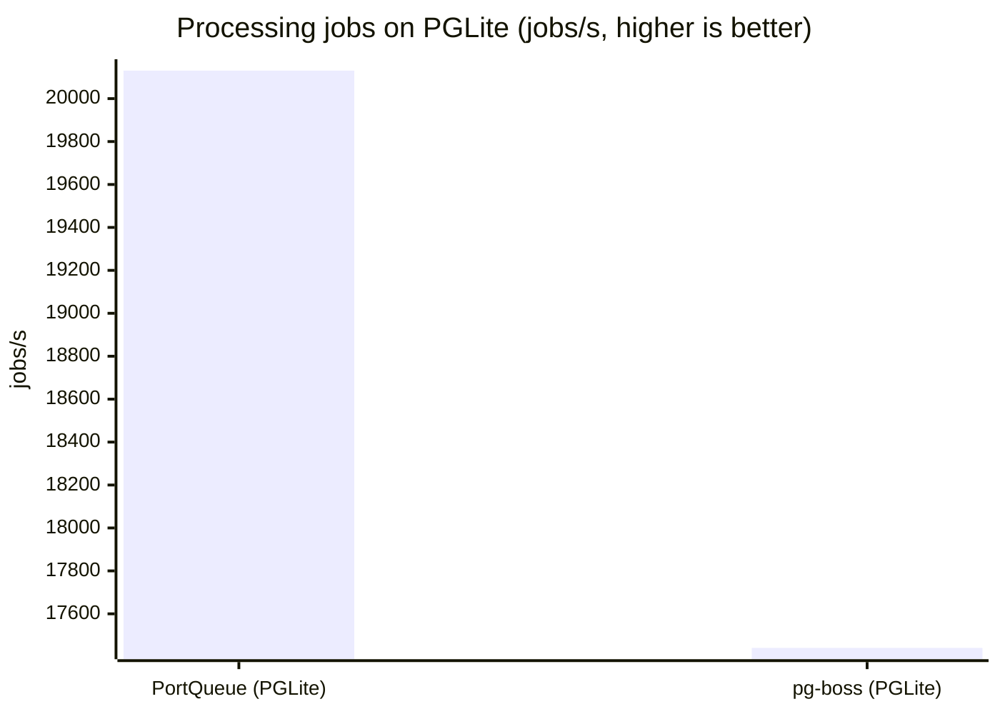
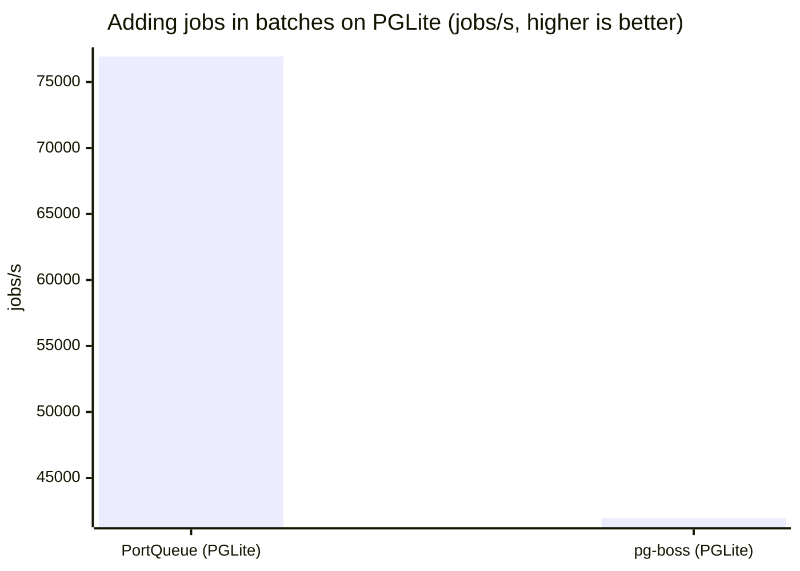
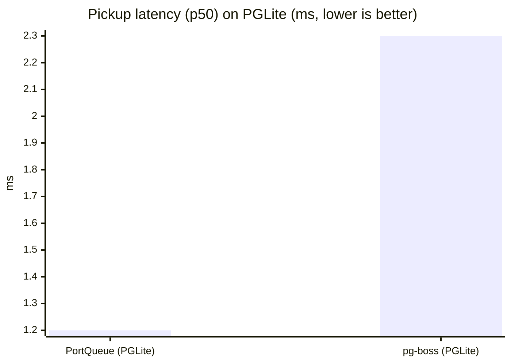

# PortQueue

**A horizontally scalable, fault-tolerant, database-agnostic, performance-focused queue implementation.**

## Documentation

📚 **[Read the full documentation →](https://episclera.github.io/portqueue/)**

- **Getting started** — [Install, first queue, core ideas](https://episclera.github.io/portqueue/docs/getting-started)
- **Guides** — [Producing jobs](https://episclera.github.io/portqueue/docs/guides/producing-jobs) · [Consuming jobs](https://episclera.github.io/portqueue/docs/guides/consuming-jobs) · [Transactional enqueue](https://episclera.github.io/portqueue/docs/guides/transactions) · [Scheduling & cron](https://episclera.github.io/portqueue/docs/guides/scheduling)
- **Operate** — [Scaling horizontally](https://episclera.github.io/portqueue/docs/scale-horizontally) · [Dashboard](https://episclera.github.io/portqueue/docs/dashboard) · [CLI](https://episclera.github.io/portqueue/docs/cli)
- **Reference** — [API reference](https://episclera.github.io/portqueue/docs/api-reference)

PortQueue treats your relational database as the single source of truth for background jobs — no Redis, no broker. Write your queue code once and run it on **PostgreSQL, MySQL, Oracle, PGLite, or SQLite** (or plug in a custom driver for any engine).

## Why PortQueue

- **One API across every driver.** Swap PostgreSQL for SQLite without touching app code.
- **Developer experience first.** Named-options objects, no positional arguments, importable enums instead of magic strings, strict types with no `any`, result objects (never bare ids), and error messages that explain the fix.
- **Horizontally scalable.** Multiple instances cooperate through row-level claiming (`SKIP LOCKED` or a safe fallback) — no double-processing.
- **Fault tolerant.** A throwing handler never crashes the worker loop.
- **Transactional enqueue.** A job is queued if and only if your surrounding DB transaction commits.
- **Feature-complete:** concurrency, rate limiting, priorities, delayed jobs, cron/recurring with timezones, idempotency, retention, backpressure, graceful shutdown.
- **Minimal footprint.** Near-zero runtime dependencies; DB clients are optional peers you choose.

## Quick start

```bash
npm install @portqueue/core
# plus the client for your database, e.g.
npm install pg   # or: mysql2, oracledb, @electric-sql/pglite, better-sqlite3
```

```ts
import { PortQueue } from '@portqueue/core';
import { PostgresqlDriver } from '@portqueue/core/drivers/postgresql';

const pq = new PortQueue({
  driver: new PostgresqlDriver({ connectionString: process.env.DATABASE_URL }),
});
await pq.init();

// Create the queue and provide a jobs handler.
pq.createQueue({
  name: 'emails',
  limiter: { concurrency: 10 },
  handler: async (job) => { await send(job.data); },
});

// Add a job to the queue.
await pq.addJob({ queue: 'emails', data: { to: 'a@b.com' } });
```

## Contributing

For full details — dev setup, conventions, running the examples, and filing issues & PRs — see the
**[Contributing guide](https://episclera.github.io/portqueue/docs/contributing)**.

## Benchmarks

How PortQueue compares with other Node.js job queues. Each chart
compares libraries on the same database driver. The charts are regenerated by
`npm run benchmark:*`.

<!-- benchmarks-summary:start -->






Last run 2026-11-17 on Apple M1 Max, Node v24.21.0. Every scenario and how it is measured: [Benchmarks](https://episclera.github.io/portqueue/docs/benchmarks).
<!-- benchmarks-summary:end -->

## License

MIT — see [LICENSE](./LICENSE). Free and open source, commercial use permitted, no obligations.
