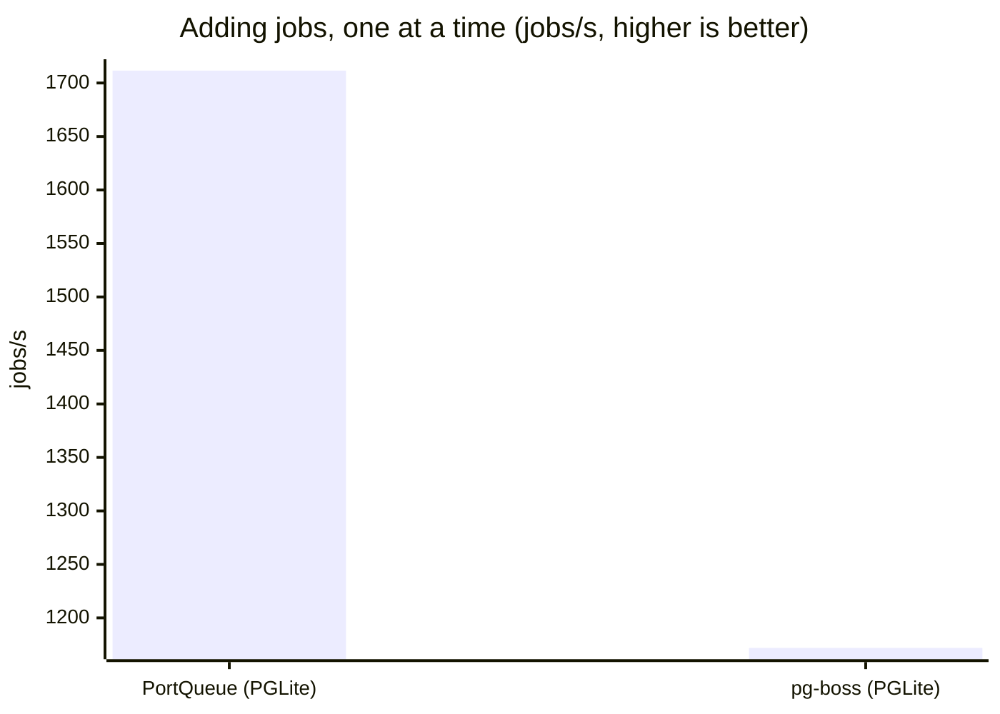
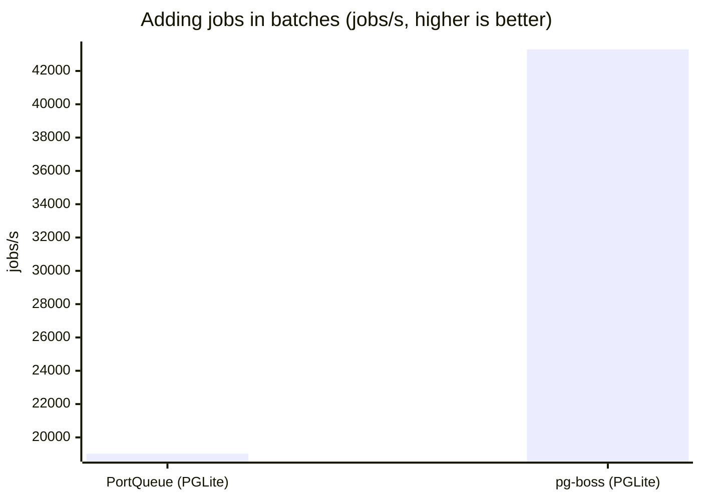
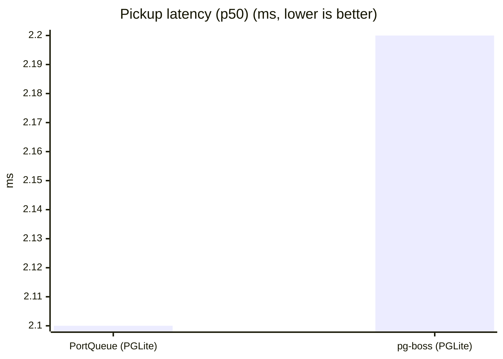

# PortQueue vs pg-boss

How [`@portqueue/core`](../../packages/core) compares with [pg-boss](https://github.com/timgit/pg-boss),
the most widely used PostgreSQL-backed job queue for Node.js. **Both run on the same engine**: an
in-memory [PGLite](https://pglite.dev) database (PostgreSQL compiled to WASM), so there is no
server to install and no network in the measurement. PortQueue uses its own `PgliteDriver`. pg-boss (v12)
runs the way its docs set it up for PGLite: `backend: 'pglite'` with the official `fromPglite`
adapter (see `src/libs/pgboss.ts`).

PortQueue comes from this repository's working tree (this folder is a workspace package), so the
numbers describe the code you have checked out, not a published release.

## Running

```bash
npm run benchmark:portqueue-vs-pgboss                # from the repo root (builds @portqueue/core first)
npm run benchmark:portqueue-vs-pgboss -- latency     # only the named scenario(s)
npm run bench                                        # from this folder (skips the build and the summary)
```

Sizes come from environment variables, so a quick smoke run uses the same code as a full one:

| Variable | Default | What it sets |
| --- | ---: | --- |
| `BENCH_REPEATS` | 3 | Fresh processes per measurement; the median is reported |
| `BENCH_ENQUEUE_SINGLE_JOBS` | 2000 | Jobs in the one-at-a-time enqueue scenario |
| `BENCH_ENQUEUE_BATCH_JOBS` | 20000 | Jobs in the batch enqueue scenario |
| `BENCH_BATCH_CHUNK` | 1000 | Jobs per batch call (PortQueue's `MAX_BATCH_IDS`) |
| `BENCH_PROCESS_JOBS` | 10000 | Jobs drained in the processing scenario |
| `BENCH_CONCURRENCY` | 100 | Jobs fetched per claim and in flight, for both libraries |
| `BENCH_LATENCY_JOBS` | 50 | Sequential round trips in the latency scenario |

Every run writes `results/results.json`, the docs data file
(`docs/src/data/benchmarks/portqueue_vs_pgboss.json`) and the results section below. The repo-root
launcher then rebuilds the summary chart on the repo README and the docs homepage.

## Scenarios

| Scenario | What is timed |
| --- | --- |
| `enqueue-single` | Sequential `pq.addJob` / `boss.send` calls, each awaited |
| `enqueue-batch` | `pq.addJobs` / `boss.insert`, 1000 jobs per call |
| `process` | Draining pre-seeded jobs with a no-op handler, until every row reads completed. Seeding is not timed. pg-boss settles each fetched batch in one statement. PortQueue settles each job on its own, fenced to the claim that ran it |
| `latency` | One job at a time on an idle worker: from the add call to the handler starting (p50) |

## How it stays fair

- **Same engine, same version.** Both libraries share the same `@electric-sql/pglite`, in memory.
- **Same timing code.** Scenarios are written once in `src/scenarios.ts` against the `Contender`
  interface in `src/contender.ts`. Each library only supplies `start`, `add`, `addMany`, `consume`,
  `waitForCompleted` and `stop`.
- **A clean database every run.** Every measurement boots a new, empty, in-memory PGLite (no
  `dataDir`, nothing on disk), so no run can see another's rows. Before timing anything it checks
  the database holds zero jobs and aborts otherwise.
- **Fresh process per run.** Every (library, scenario, repeat) runs in its own child process, so no
  run inherits another's heap, JIT warm-up or database. The reported number is the median run.
- **Equal claim settings.** PortQueue runs `limiter: { concurrency: N, batchSize: N }`. pg-boss runs
  one worker with `batchSize: N` whose handler runs the batch concurrently, so both fetch N per claim
  and keep N in flight.
- **"Done" means settled in the database.** PortQueue counts `JOB_COMPLETED`, which fires after the row
  is settled. pg-boss emits nothing per job, so it waits for its handlers and then for
  `pgboss.job` to report every row `completed`.
- **pg-boss tuned for its best showing.** `useListenNotify` and the queue's `notify: true` wake its
  workers as soon as a job is added. PGLite supports LISTEN/NOTIFY in process, so this matches
  PortQueue's in-process wakeup. `burstWhenBatchFull` keeps it fetching with no delay while
  batches come back full, matching PortQueue's claim loop. `pollingIntervalSeconds: 0.5` (its
  minimum) is only the backstop.

PGLite runs single-connection inside one process, which is not how either library runs in
production against a PostgreSQL server. The numbers compare the libraries' own overhead on the same
engine. They don't predict throughput against a networked database.

## Results

<!-- benchmark-results:start -->
_Last run 2026-11-17 on Apple M1 Max (10 cores), darwin arm64, Node v24.21.0, PGLite 0.2.17; median of 3 runs. Versions: PortQueue 1.2.1, pg-boss 12.38.2._

### Adding jobs, one at a time

2000 sequential `addJob` / `send` calls, each awaited.



| Library | jobs/s | elapsedMs | jobs |
| --- | ---: | ---: | ---: |
| PortQueue | **1,711.6** | 1,168.5 | 2,000 |
| pg-boss | **1,171.9** | 1,706.6 | 2,000 |

### Adding jobs in batches

20000 jobs through `addJobs` / `insert`, 1000 per call.



| Library | jobs/s | elapsedMs | jobs |
| --- | ---: | ---: | ---: |
| PortQueue | **19,017.9** | 1,051.6 | 20,000 |
| pg-boss | **43,292.6** | 462 | 20,000 |

### Processing jobs

10000 pre-seeded jobs drained by a no-op handler, 100 fetched per claim and in flight; timed until every job is settled.


| Library | jobs/s | elapsedMs | jobs | concurrency |
| --- | ---: | ---: | ---: | ---: |
| PortQueue | **2,673.1** | 3,740.9 | 10,000 | 100 |
| pg-boss | **17,085.4** | 585.3 | 10,000 | 100 |

### Pickup latency (p50)

50 sequential jobs on an idle worker, timed from the add call to the handler starting.



| Library | ms | p50Ms | p95Ms | maxMs | jobs |
| --- | ---: | ---: | ---: | ---: | ---: |
| PortQueue | **2.1** | 2.1 | 2.8 | 5.4 | 50 |
| pg-boss | **2.2** | 2.2 | 3.2 | 6.8 | 50 |

<!-- benchmark-results:end -->
